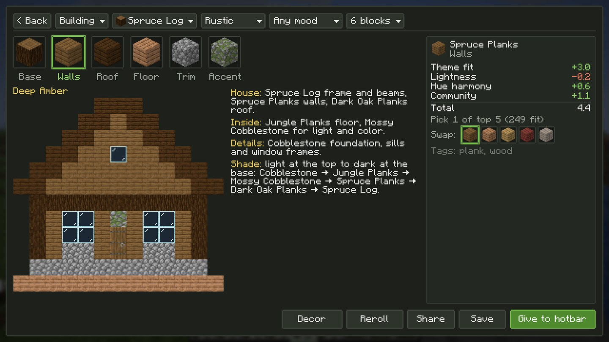
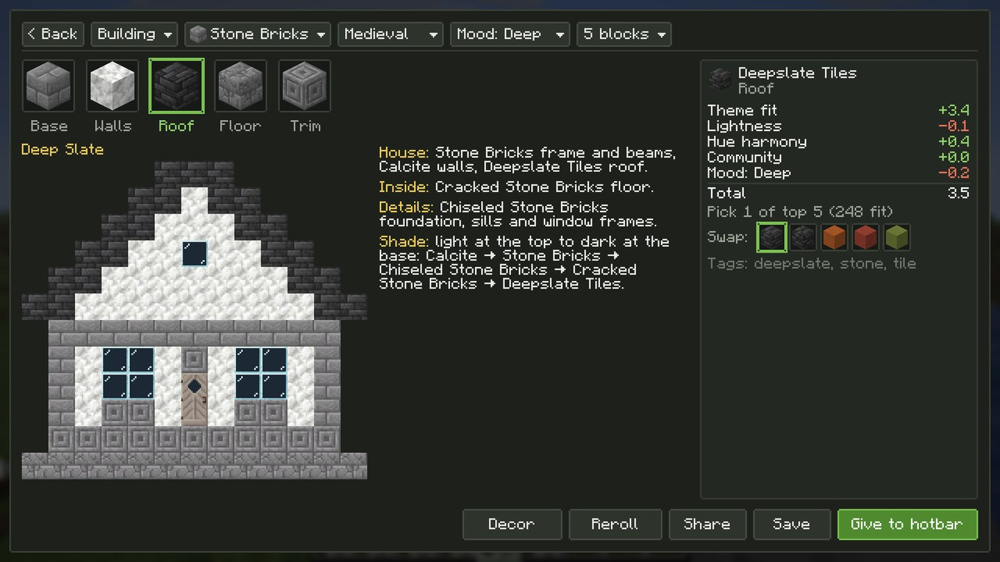
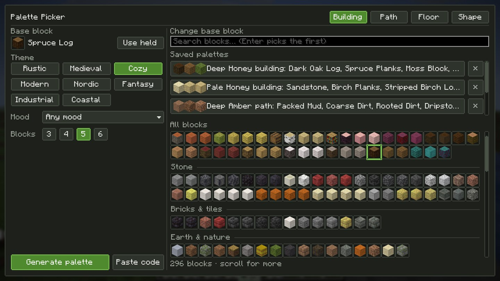
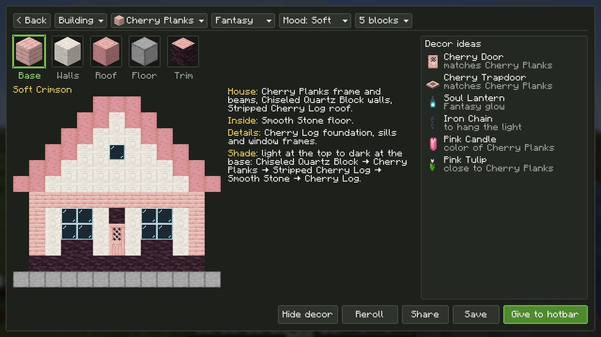
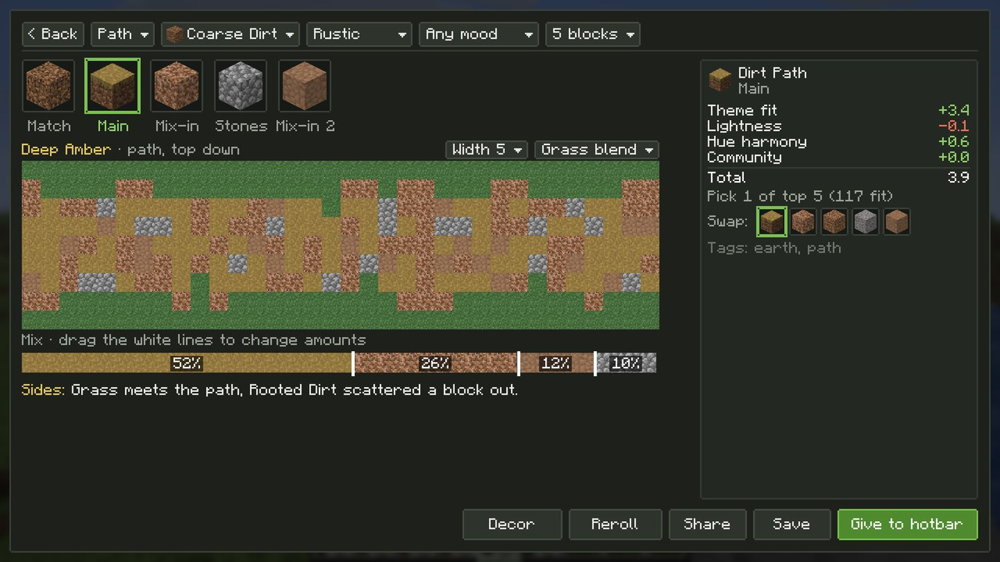
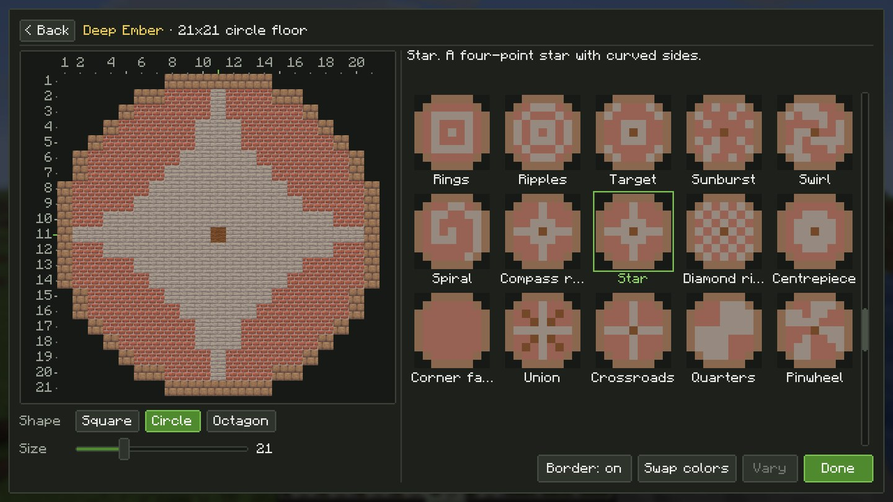
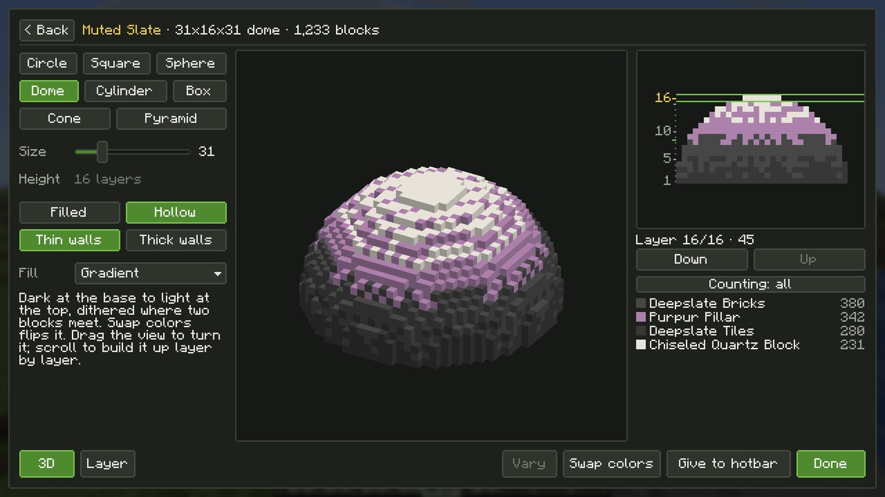
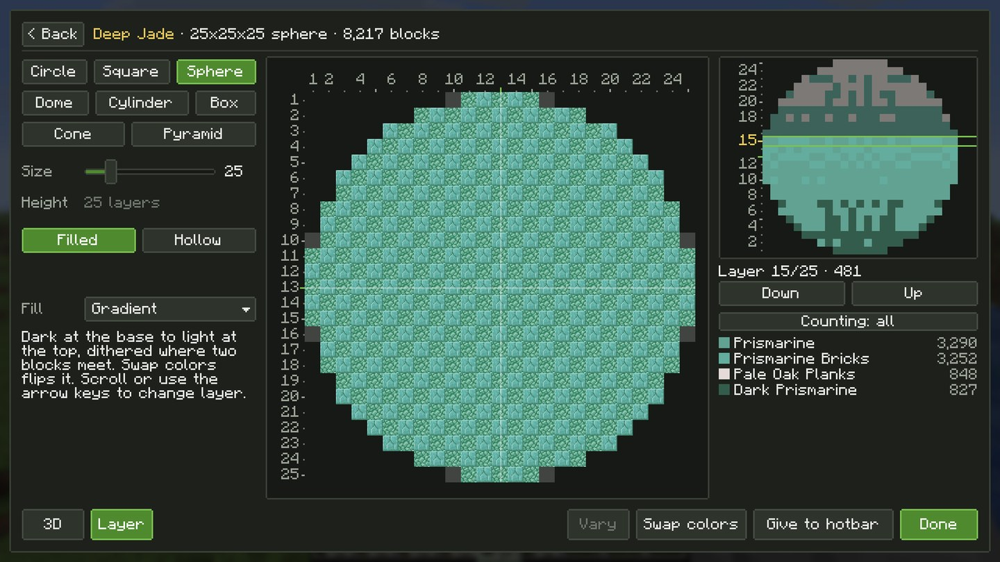

# Palette Picker

A client-side Fabric mod for Minecraft 26.3. Press **B**, pick a base block, a theme and a mood, and get a set of blocks that go together, for a building, a path, a floor or a shape.

  
  

## How it works

- Press **B** in a world to open the picker.
- Choose what you're building: **Building**, **Path**, **Floor** or **Shape**.
- Pick a base block: search for it, click it in the block grid, or use the one in your hand.
- Pick a theme, a mood and how many blocks you want (3 to 6), then **Generate palette**.
- Don't like a block? Click it to see why it was picked and swap in another. Lock the ones you like and **Reroll** the rest.
- You can change the key in **Options → Controls → Key Binds → Palette Picker**.

  
  

## Modes

### Buildings

Walls, roof, floor, trim and accent, picked to match your base block, with stairs, slabs and walls listed where they exist. A small house preview shows how it looks together, and **Decor** suggests doors, trapdoors, fences, lights, candles, carpets and plants that suit it.

### Paths

Ground blocks only: a main block, mix-ins, stones, patches and an optional edge. Pick 3, 5 or 7 wide, blended into grass or with a border, and drag the bar to change how much of each block goes in.

  
  

### Floors

Around 75 patterns (checkers, herringbone, tiles, spirals, stars and more) with a thumbnail browser. Square, circle or octagon, any size from 5 to 64, with a border, swapped colors and block-number rulers for counting.

### Shapes

Circle, square, sphere, dome, cylinder, box, cone and pyramid, sizes 5 to 126. Solid or hollow, filled with a gradient, bands, speckle or trim rings. Drag to turn it in 3D, or go layer by layer with the layer below ghosted and a count of each block.

  
  

## Themes and moods

- **Themes:** Rustic, Medieval, Cozy, Modern, Nordic, Fantasy, Industrial, Coastal.
- **Moods:** Any, Pale, Soft, Muted, Deep, Dark.

## Getting the blocks

- **Creative:** **Give to hotbar** puts the palette in your hotbar. Your items are never deleted: they move to free slots, or the slot is skipped.
- **Survival:** the checklist lists every block (with stairs, slabs and walls) so you can tick them off as you gather.

## Save and share

Save palettes to come back to later; they show up on the first screen. **Share** copies a `pp1:` code you can paste in chat or send to a friend, and **Paste code** on the first screen opens it.

## Modded blocks

Full-cube blocks from other mods show up automatically, colored from their textures.

## Requirements

- Minecraft 26.3
- [Fabric Loader](https://fabricmc.net/use/) 0.20.1 or newer
- [Fabric API](https://modrinth.com/mod/fabric-api)
- Java 25

## Install

Download the jar from [Releases](../../releases) and put it in your `mods` folder with Fabric API.

The mod is client only, so it works on any server and the server doesn't need it.

## License

[MIT](LICENSE)
